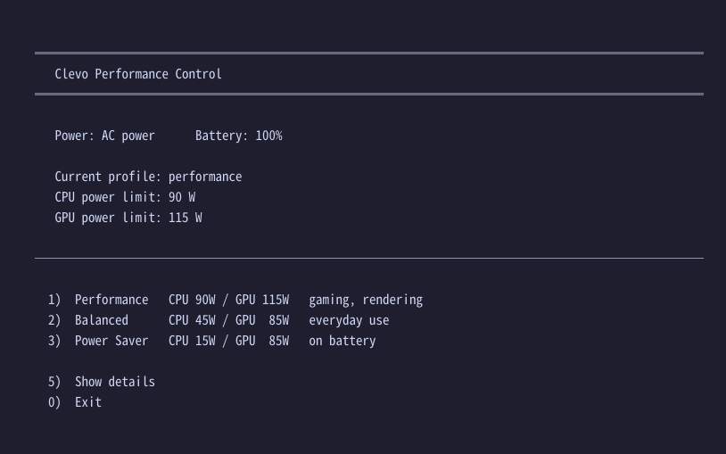
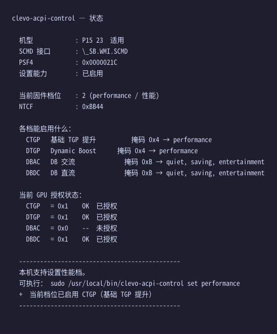

# clevo-acpi-control

**[中文](README.zh-CN.md) | English**

Control performance profiles on **Clevo / Tongfang** laptops through the vendor's
own ACPI interface — including unlocking the NVIDIA laptop GPU TGP / Dynamic Boost
that firmware locks behind a Windows-only authorization flag.

No firmware flashing. No vBIOS patching. No driver patching.
It calls the exact same ACPI method the Windows Control Center does.

```bash
sudo clevo-acpi-control status
sudo clevo-acpi-control set performance
```

---

## ⚠️ Supported hardware (read this first)

### ✅ Only: COLORFUL **P15 / P16 (2024 models)**

| Model | Status |
|---|---|
| COLORFUL **P15** (DMI reports `P15 23`, BIOS `1.07.10COLO2` 2024-04-26) | ✅ **fully verified** |
| COLORFUL **P16** (2024) | ⚠️ untested, likely identical |

### ❌ Do not use on anything else

This `SCMD` interface is Clevo/Insyde's customization for COLORFUL.
**Calling it on another machine may corrupt EC registers.**

Explicitly not supported (completely different EC / ACPI interfaces):

```
MSI / ASUS / Lenovo / Dell / HP / Acer / Razer
and other brands' Clevo/Tongfang barebones
(XMG / Monster / Eluktronics / Sager / Metabox / MECHREVO / Avell …)
```

**Check before you touch anything** (read-only, zero risk):

```bash
sudo clevo-acpi-control status
```

If `PSF4` cannot be read, or there is no `\_SB.WMI.SCMD` interface, it does not apply.

> The tool also checks the DMI product name and refuses to write on non-P15/P16
> machines unless you pass `--force`.

---

## The problem it solves

Many Clevo/Tongfang-built laptops (COLORFUL, XMG, Monster, Eluktronics, Sager,
MECHREVO …) reach their rated TGP — for example RTX 4060 Laptop at 140 W instead
of 85 W — only when the Windows Control Center switches to its "Performance" profile.

**On Linux that profile is always off.** The firmware keeps an authorization flag
that only the Windows app ever sets. The symptom is visible in the logs:

```
nvidia-powerd[921]: ERROR! Client (presumably SBIOS) has requested to
                    disable Dynamic Boost DC controller
```

`nvidia-smi -pl` cannot help either — laptop GPU power limits are fixed by the
vBIOS/EC and the driver refuses runtime changes:

```
$ sudo nvidia-smi -pl 115
Changing power management limit is not supported in current scope
```

This tool calls the ACPI method directly and sets that flag.

---

## How it works

The vendor Control Center is just a kernel driver (`AcpiBridge.sys`, bound to
`ACPI\CLV0001`) plus a UI. It translates `DeviceIoControl` into ACPI calls.
The real logic lives in firmware:

```
Control Center UI
  → DeviceIoControl({86994c74-ad43-4812-b7e7-0c420b5c5fd7})
  → AcpiBridge.sys  (bound to ACPI\CLV0001 = \_SB.DCHU)
  → \_SB.DCHU._DSM(UUID 93f224e4-fbdc-4bbf-add6-db71bdc0afad, rev, func, data)
  → SCMD / GCMD / CC30
  → EC + NPCF
```

The one call that matters:

```
\_SB.WMI.SCMD 0 0x79 0x1900000N
                │    │       └── profile: 0=quiet 1=saving 2=performance 3=entertainment
                │    └────────── sub-command 0x19 = set performance profile
                └─────────────── extended-command entry point
```

Inside, firmware then:

1. writes `EC.CPCM` (current profile register — fan curve and power tables follow)
2. notifies DPTF
3. sets the `NPCF` authorization bits according to the `NTCF` bitmask:
   - `CTGP` — base TGP raise
   - `DTGP` — Dynamic Boost
   - `DBAC` / `DBDC` — Dynamic Boost on AC / DC

Full reverse-engineering notes (ACPI paths, `_WDG` GUIDs, command dispatch tables,
`NTCF` bitmask layout, `PSF4` physical address, driver analysis) are in
**[docs/PROTOCOL.md](docs/PROTOCOL.md)**.

---

## Verified results

On a COLORFUL P15 23, **on AC power**, after `set performance`:

| Metric | Before | After |
|---|---|---|
| GPU `Current Power Limit` | **85 W** | **115 W** |
| CPU PL1 | 45 W | **90 W** |
| `CPCM` (firmware profile) | `0x3` entertainment | `0x2` performance |
| `NPCF.CTGP` (TGP authorization) | `0x0` | `0x1` |

### All four profiles measured (AC power, idle)

| Profile | CPU PL1 | GPU limit |
|---|---|---|
| quiet (0) | 15 W | 85 W |
| saving (1) | **15 W** | 85 W |
| entertainment (3) | 45 W | 85 W |
| performance (2) | **90 W** | **115 W** |

> `quiet` and `saving` have **identical** power limits (both 15 W).
> The saving profile is effectively pointless and is not mapped.

---

## Install

Requires the `acpi_call` kernel module. Fedora users can use the DKMS package
[MiMillieuh/acpi_call-fedora](https://github.com/MiMillieuh/acpi_call-fedora);
Debian/Ubuntu users `sudo apt install acpi-call-dkms`.

The installer builds the module automatically if needed (kernel 5.6+ needs the
patch in `patches/` — the upstream code is from 2013 and does not compile).

```bash
git clone https://github.com/SilverKurali/clevo-acpi-control.git
cd clevo-acpi-control
sudo ./install.sh
```

What it installs:

| Path | Purpose |
|---|---|
| `/usr/local/bin/clevo-acpi-control` | CLI tool |
| `/usr/local/bin/clevo` | interactive menu |
| `/lib/modules/$(uname -r)/extra/acpi_call.ko` | kernel module |
| `/etc/modules-load.d/clevo-acpi-control.conf` | load module at boot |
| `/etc/sudoers.d/clevo-acpi-control` | passwordless for these two binaries only |
| `/usr/share/applications/clevo-acpi-control.desktop` | app-menu entry |
| `/etc/systemd/system/clevo-acpi-control.service` | optional apply-at-boot |
| `/etc/clevo-acpi-control.conf` | boot profile setting |

Uninstall:

```bash
sudo ./install.sh --uninstall
```

---

## Usage

### GUI

App menu → **Clevo Performance Control** (or run `clevo` in a terminal).
A numbered menu, no commands to memorise:



```
  ╔══════════════════════════════════════════╗
  ║          Clevo Performance Control       ║
  ╚══════════════════════════════════════════╝

     Power: AC        Battery: 100%

     Current profile: entertainment (balanced)
     CPU power limit: 45 W
     GPU power limit: 85 W

  ──────────────────────────────────────────

    1)  Performance   CPU 90W / GPU 115W   gaming, rendering
    2)  Balanced      CPU 45W / GPU  85W   everyday use
    3)  Power Saver   CPU 15W / GPU  85W   on battery

    5)  Show details
    0)  Exit
```

### CLI

```console
$ sudo clevo-acpi-control status
```



```bash
sudo clevo-acpi-control status                    # read-only, safe
sudo clevo-acpi-control probe                     # read-only, dumps known commands
sudo clevo-acpi-control set performance --dry-run # show what would run
sudo clevo-acpi-control set performance
sudo clevo-acpi-control set quiet
```

### Verify it worked

```bash
nvidia-smi -q -d POWER | grep -A2 'Power Limit'
journalctl -u nvidia-powerd -n 5
```

You should see `Current Power Limit` rise above the default, and fan speed change
(the EC profile changed too).

### Desktop integration — one switch for both layers (recommended)

The desktop power mode and the firmware profile are **independent** by default:
the desktop switch only touches the CPU governor, and the firmware profile only
changes when you run this tool.

Enabling the sync service joins them:

```bash
sudo systemctl enable --now clevo-profile-sync
```

| Desktop power mode | Firmware profile | CPU PL1 | GPU limit |
|---|---|---|---|
| Power Saver | quiet (0) | 15 W | 85 W |
| Balanced | entertainment (3) | 45 W | 85 W |
| Performance | performance (2) | **90 W** | **115 W** |

Now changing the power mode in the top-right menu changes the firmware profile too —
fan curve, CPU power limit and GPU TGP all follow.

The mapping is configurable in `/etc/clevo-acpi-control.conf`:

```ini
PROFILE_POWER_SAVER=quiet
PROFILE_BALANCED=entertainment
PROFILE_PERFORMANCE=performance
```

It listens on `net.hadess.PowerProfiles` (provided by `power-profiles-daemon` or
`tuned-ppd` — Fedora 41+ uses the latter), so it works on GNOME, KDE and any
desktop that implements that interface.

### Apply a fixed profile at boot (alternative)

```bash
# edit /etc/clevo-acpi-control.conf to pick the profile, then:
sudo systemctl enable --now clevo-acpi-control
```

---

## Safety

| Operation | Risk |
|---|---|
| `status` / `probe` | **none** — read-only commands only |
| `set <profile>` | low–medium — writes EC registers, notifies DPTF |

- If `SCMD` returns `0xFFFFFFFFFFFFFFFF`, the command was skipped by firmware.
  Nothing was changed.
- Run `probe` first if unsure the interface is reachable.
- To recover from anything: hold the power button. Profiles are not persistent —
  a reboot returns to the firmware default.

### Known pitfalls

**Do not** call `\_SB.DCHU.MMWB` — it writes arbitrary physical memory and will
lock the machine if given wrong arguments. This project does not use it.

**Do not** run this on non-Clevo/Tongfang machines — EC register meanings differ
completely.

### Note on battery

On battery, the GPU is capped at **35 W** by firmware and Dynamic Boost is
disabled — the TGP increase is only observable on AC power. This is by design.

---

## Project status

- [x] Full ACPI protocol reverse-engineered (line-by-line DSDT verification)
- [x] Vendor driver analysis (`AcpiBridge.sys` call chain)
- [x] Offline validation of the calling convention (`acpiexec`)
- [x] **Hardware-verified: GPU power limit 85 W → 115 W**
- [x] All four profiles measured
- [x] One-command install + interactive menu + desktop entry
- [x] **D-Bus integration — desktop power mode drives the firmware profile**
- [ ] Fan RPM readout

---

## Credits

- [siphomateke/tongfang-control](https://gitlab.com/siphomateke/tongfang-control) —
  unofficial Tongfang control center; the reference for WMI reverse-engineering methodology
- [MiMillieuh/tongfang-laptop-linux-guide](https://github.com/MiMillieuh/tongfang-laptop-linux-guide) —
  Tongfang-on-Linux guide
- [MiMillieuh/acpi_call-fedora](https://github.com/MiMillieuh/acpi_call-fedora) —
  `acpi_call` DKMS packaging for Fedora
- [tuxedocomputers/tuxedo-cc-wmi](https://github.com/tuxedocomputers/tuxedo-cc-wmi) —
  Tuxedo (Clevo/Uniwill) WMI kernel driver
- [mkottman/acpi_call](https://github.com/mkottman/acpi_call) — the ACPI call module
- [YoyPa/isw](https://github.com/YoyPa/isw) — Clevo EC register map reference

## License

GPL-3.0
